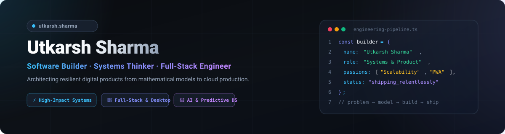

<div align="center">



<br />

<a href="https://github.com/shutkarshX"></a>

</div>

<br />

## `01 / identity`

### Utkarsh Sharma
**B.Tech CSE (Data Science) · Software Builder · Systems Thinker**

I build practical software around real-world problems — from educational simulation platforms and multi-tier systems to browser automation, machine learning pipelines, and AI-assisted decision command centers.

I care about the part after the idea: **architecting dataflow, wiring system boundaries, testing edge cases rigorously, and making systems that survive contact with real usage.**

```text
problem  →  model  →  build  →  verify  →  refine  →  ship
```

---

## `02 / featured projects`

<table>
<tr>
<td width="50%" valign="top">

### [RESQ-AI](https://github.com/shutkarshX/resq-ai)
**AI-Assisted Disaster Response Command Center**

Full-stack operational command center combining incident intake, geospatial risk prioritization, Google Gemini tactical directives, and rescue-team dispatch tracking.

`FastAPI` `React` `TypeScript` `Leaflet` `Gemini AI` `SQLite`

<a href="https://github.com/shutkarshX/resq-ai">↗ Explore Repository</a>

</td>
<td width="50%" valign="top">

### [Operating Systems Platform](https://github.com/shutkarshX/Integrated-National-Citizen-Services-Platform)
**Citizen Services & CPU Scheduling Simulation Lab**

A dual-tier operating system study platform featuring a public citizen services intake portal and an interactive Gantt-chart CPU scheduling lab (FCFS, SJF, Priority, Round Robin). Verified by 166 automated test cases.

`Python` `Zero-Dependencies` `Pytest` `166 Tests Passed`

<a href="https://github.com/shutkarshX/Integrated-National-Citizen-Services-Platform">↗ Explore Repository</a>

</td>
</tr>
<tr>
<td width="50%" valign="top">

### [Scholarship Allocation System](https://github.com/shutkarshX/Scholarship-Allocation-System)
**DSA-II Decision-Support & Optimization Engine**

Transparent financial aid allocation engine utilizing hash indexing, binary max-heaps, 0/1 Knapsack Dynamic Programming, and Branch-and-Bound optimality cross-checks under strict institutional budgets.

`Python` `Flask` `Knapsack DP` `Branch & Bound` `41 Tests Passed`

<a href="https://github.com/shutkarshX/Scholarship-Allocation-System">↗ Explore Repository</a>

</td>
<td width="50%" valign="top">

### [Prodigy-Infotech Suite](https://github.com/shutkarshX/Prodigy-Infotech)
**Applied Data Science & Machine Learning Tasks**

Comprehensive suite of 5 real-world data science projects: demographic distributions, Titanic survival EDA, bank marketing decision trees, Twitter NLP sentiment classification, and geospatial traffic accident risk mining.

`Python` `Pandas` `Scikit-Learn` `Matplotlib` `Seaborn`

<a href="https://github.com/shutkarshX/Prodigy-Infotech">↗ Explore Repository</a>

</td>
</tr>
<tr>
<td width="50%" valign="top">

### [Speedo](https://github.com/shutkarshX/Speedo)
**Multi-Platform Course & Test Automator**

Modular Chrome Extension (Manifest V3) built with a platform adapter architecture for automated learning pathway progression, CSP-safe execution, and adaptive video playback acceleration.

`Chrome Extension` `Manifest V3` `JavaScript` `Service Workers`

<a href="https://github.com/shutkarshX/Speedo">↗ Explore Repository</a>

</td>
<td width="50%" valign="top">

### [EcoRewards](https://github.com/shutkarshX/EcoRewards)
**Campus Waste Segregation & Sustainability Platform**

Gamified Design Thinking (DT) web prototype that transforms campus waste segregation into habit-forming behavior through weight-based eco-points, awareness quizzes, and canteen reward vouchers.

`React 18` `Vite` `JavaScript` `Design Thinking` `SDG 12`

<a href="https://github.com/shutkarshX/EcoRewards">↗ Explore Repository</a>

</td>
</tr>
</table>

---

## `03 / engineering stack`

| Domain | Technologies & Frameworks |
| :--- | :--- |
| **Languages** | `Python` · `JavaScript` (ES2022) · `TypeScript` · `C` (C99) · `Java` (17+) · `R` |
| **Web & UI** | `React 18` · `Vite` · `Tailwind CSS` · `Java Swing` · `HTML5` · `CSS3` |
| **Backend & APIs** | `FastAPI` · `Flask` · `RESTful Architecture` · `TCP Sockets` · `Uvicorn` |
| **Data & ML** | `Pandas` · `NumPy` · `Scikit-Learn` · `R Shiny` · `ggplot2` · `dplyr` |
| **Databases** | `SQLite` · `SQLAlchemy ORM` · File Persistence (`JSON` / `CSV`) |
| **DevOps & Tools** | `Git` · `GitHub Actions` · `Pytest` · `Unittest` · `Chrome Extensions MV3` |

---

## `04 / engineering rhythm`

<div align="center">


<sub>contribution history rendered via automated GitHub Action</sub>

</div>

---

## `05 / working principles`

- **Build before over-explaining:** A functioning prototype with unit tests beats a 20-page proposal every time.
- **Automate the friction:** Make repetitive, manual workflows disappear with clean software.
- **Treat edge cases as core product:** The boundary conditions define real reliability.
- **Transparent architecture:** Clear separation of concerns, modular adapters, and reproducible setups.
- **Iterative rhythm:** Ship → inspect telemetry → verify edge cases → improve.

---

<div align="center">

### `let's build something impactful.`

<a href="https://github.com/shutkarshX">GitHub</a> ·
<a href="https://www.linkedin.com/in/utkarsh-sharma-25403a3b5/">LinkedIn</a> ·
<a href="https://instagram.com/shut.karsh">Instagram</a>

<br /><br />

<sub>Clean Markdown · GitHub Actions CI · Tested Systems · Continuous Growth</sub>

</div>
